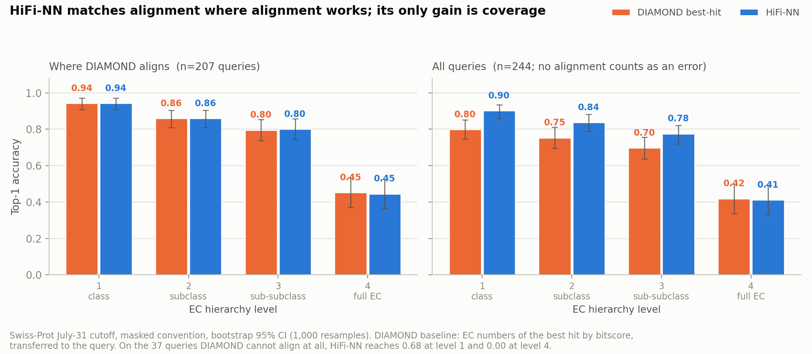
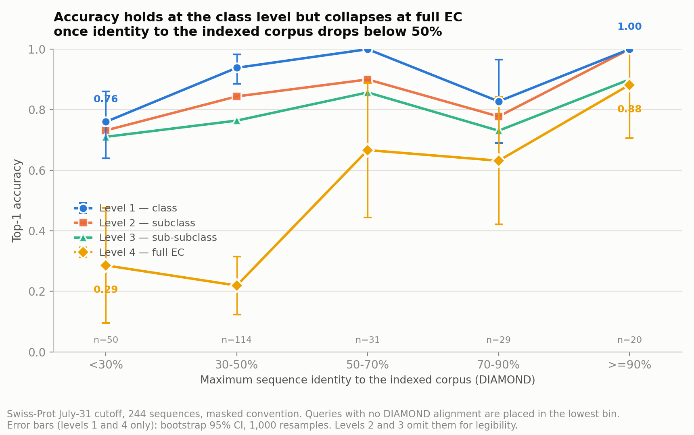
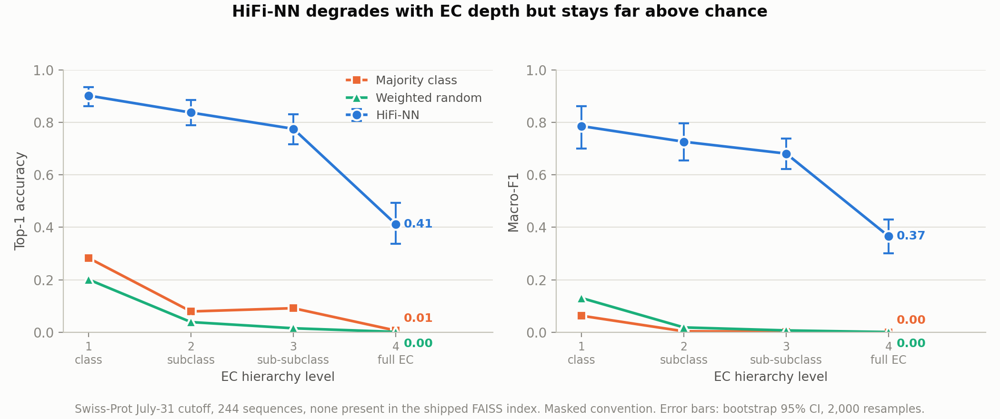
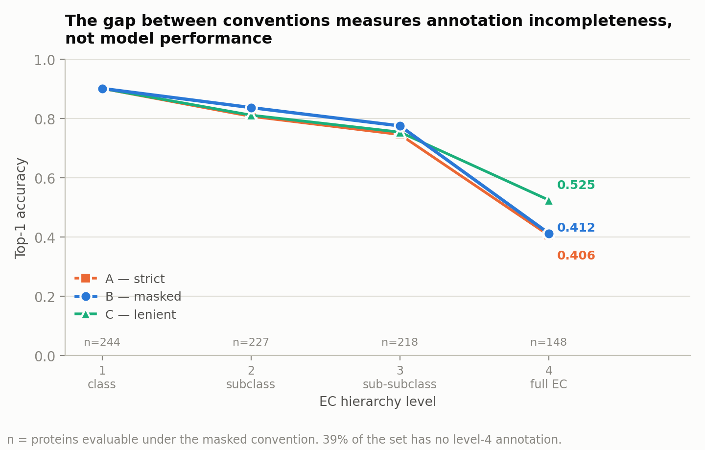

# Benchmarking HiFi-NN on a leakage-checked, identity-stratified test set

An independent reproduction of [HiFi-NN](https://github.com/basecamp-research/hifinn)
(Basecamp Research), run end to end on a Windows laptop, with an evaluation
designed around two questions the released code does not answer on its own:

1. **Is the test set actually held out?**
2. **Does the model still work when the query has no close homologue** — which is
   the only situation where an embedding-based annotator should beat alignment?

This is a small independent study, not a critique of the method. Everything here
was produced from the public release and the artefacts shipped with it.

---

## Summary

**HiFi-NN matches DIAMOND where DIAMOND works, and its only gain is coverage.**
On the 207 of 244 queries DIAMOND aligns, the two methods are statistically
indistinguishable at every level of the EC hierarchy. On the 37 queries DIAMOND
cannot align at all, HiFi-NN assigns the correct enzyme class 68% of the time —
and the correct full EC number 0% of the time (0 of 11).

**Accuracy collapses with EC depth.** Top-1 accuracy falls from 0.902 at the
class level to 0.412 [0.331, 0.493] at the full four-digit EC number.

**Two of the three test sets shipped with the model are unusable as benchmarks.**
The `IterativeClustering/clusterNN` files are ~100% contained in the released
FAISS index, so every query returns itself as its own nearest neighbour.

**Three defects in the released code** prevent the pipeline from running, or
silently corrupt its output, outside the authors' environment. All three have
short fixes, given below and in PATCHES.md.

---

## Figures









---

## 1. Running the release outside the authors' environment

The pipeline runs, but not out of the box. Nine distinct obstacles were hit on
Windows 11 / Python 3.10 / PyTorch 2.14 CPU. Six are environment issues
(documented in NOTES.md); three are defects in the code itself.

### 1.1 Output filenames derive from the full FASTA header

`esm/scripts/extract.py` names each output tensor after the entire header line
rather than the accession. The shipped `swissprot_July31_cutoff_ec.fasta` has
headers of the form `A0A8I5ZNK2 <unknown description>`, whose `<`, `>` and spaces
are illegal in Windows filenames. The run aborts on the first batch with
`RuntimeError: open file failed with error code: 123` (`ERROR_INVALID_NAME`).
Those characters are legal on Linux and macOS, so the bug is invisible there.

*Fix:* sanitise headers to the bare accession before embedding. This is required
regardless, since `swissprot_July31_cutoff_id_to_ec.json` is keyed on bare
accessions while `load_embeddings` derives ids from filename stems.

### 1.2 The HiFi-NN batch size is not configurable and defaults to 32

`annotate.py` calls `embed_queries` without `batch_size`. Because
`batch_collate_fn` pads every sequence in a batch to the longest one, 32
sequences padded to 1,022 residues allocate a `32 x 20 x 1022^2` float32
attention tensor in `MultiheadAttention.forward` — a single 2.67 GB allocation,
which fails on a 16 GB laptop.

*Fix:* expose `batch_size` in `configs/annotate.yaml`. At 4, the peak is ~330 MB
with no effect on the results.

### 1.3 The confidence softmax underflows, yielding NaN on remote queries

`get_confidence_scores` computes `exp(-d/T) / sum_k exp(-d_k/T)` with `T = 0.001`
and no log-sum-exp shift. Since `exp(-d/0.001) = exp(-1000d)`, every term
underflows to zero in float64 once all k distances exceed roughly 0.75, the
denominator becomes zero, and the confidences are `NaN`.

On this test set that affected **56 of 244 queries (23%)** — by construction,
exactly the queries with no close neighbour in the index, which are the ones a
benchmark most needs to measure. The same pattern appears in
`get_confidence_and_distance`.

*Fix:* subtract `min(d)` from both numerator and denominator. Algebraically
identical, numerically stable, removes every NaN.

### 1.4 A trap rather than a bug

`get_model_embeddings_from_dl` writes intermediate embeddings to
`./hifinn_embeddings/` and then reloads the **entire** directory, so a previous
run's results silently contaminate the next one unless that directory is cleared
between runs. This produces no error — only wrong numbers.

---

## 2. Choosing a test set

The release ships several candidate evaluation sets. Cross-referencing each one
against the 274,201 ids in the released FAISS index:

| Set | Sequences | Labelled | Present in the index |
|---|---|---|---|
| `IterativeClustering/cluster10` | 218 | yes | **218** |
| `IterativeClustering/cluster30` | 207 | yes | **207** |
| `IterativeClustering/cluster50` | 202 | yes | **202** |
| `IterativeClustering/cluster90` | 211 | yes | **212** |
| `swissprot_July31_cutoff_ec` | 244 | yes | 0 |
| `price` | 149 | **no** | 0 |

Querying a `clusterNN` set against the shipped index returns each sequence as its
own nearest neighbour at zero distance, with its own EC label. These files are
almost certainly the authors' internal clustering splits rather than held-out
benchmarks; nothing in the repository flags them as unsuitable for evaluation.
`make_db.py` accepts an optional id list, so the index can be rebuilt with those
ids excluded — but that was out of scope here.

`price.fasta` carries RefSeq `WP_` accessions that are absent from
`swissprot_all_ec_nums.json`, so it has no ground truth to score against.

**This work therefore evaluates on `swissprot_July31_cutoff_ec`**: 244 sequences,
fully labelled, zero id overlap with the index.

### 2.1 Residual leakage at the sequence level

Id-level disjointness is not sequence-level disjointness. Aligning the 244
queries against `reduced30_train.fasta` (the 274,201 indexed sequences) shows:

- **20 queries are >= 90% identical** to an indexed sequence;
- **9 are 100% identical**, under a different accession.

For example `A5U3A6` is the same protein as the indexed `P9WI75` — two Swiss-Prot
entries for different *M. tuberculosis* strains. These 20 proteins inflate the
pooled figures; the stratified results in section 4.2 separate them out.

---

## 3. Evaluation protocol

### 3.1 Partial ground-truth annotations

39% of the test set has no complete EC number. Ground truth of the form
`4.-.-.-` means curators established the class and did not resolve the rest — an
absence of information, not a negative label.

| Level | Proteins whose truth is specified |
|---|---|
| 1 — class | 244 / 244 (100%) |
| 2 — subclass | 227 / 244 (93%) |
| 3 — sub-subclass | 218 / 244 (89%) |
| 4 — full EC | 148 / 244 (61%) |

Scoring `4.2.2.17` as wrong against a truth of `4.-.-.-` would cap F1 at 0.61 by
construction, measuring Swiss-Prot's completeness rather than the model. Three
conventions are therefore computed:

- **A — strict.** Truth truncated literally, `-` included.
- **B — masked.** Each protein scored only at the levels where its truth is
  specified. CAFA-style; **this is the headline number**.
- **C — lenient.** A prediction consistent with the partial truth counts correct.

The gap between A and C is itself a measurement of annotation incompleteness
(figure 2). It stays under 3 points through level 3 and opens to 12 points at
level 4.

### 3.2 Metrics

Top-1 accuracy is the fraction of proteins whose highest-confidence predicted EC
is among the true labels. Macro-F1 averages per-class F1 unweighted, so a class
with one example counts as much as one with eighty. Both are reported because
accuracy alone is dominated by frequent classes.

All confidence intervals are bootstrap 95% CIs over proteins, resampled with
replacement.

---

## 4. Results

### 4.1 Pooled, masked convention

| Level | n | Accuracy | 95% CI | Macro-F1 | Classes | Majority baseline | Weighted random |
|---|---|---|---|---|---|---|---|
| 1 | 244 | 0.902 | [0.861, 0.934] | 0.786 | 7 | 0.283 | 0.201 |
| 2 | 227 | 0.837 | [0.789, 0.885] | 0.726 | 40 | 0.079 | 0.039 |
| 3 | 218 | 0.775 | [0.716, 0.830] | 0.681 | 69 | 0.092 | 0.015 |
| 4 | 148 | 0.412 | [0.331, 0.493] | 0.366 | 101 | 0.007 | 0.001 |

Null baselines are computed from the EC distribution of the index itself
(274,501 entries): always predicting the most frequent class, and drawing
labels in proportion to their frequency (averaged over 200 draws).

### 4.2 Stratified by sequence identity to the indexed corpus

DIAMOND `blastp --ultra-sensitive`, 244 queries against the 274,201 indexed
sequences. Queries with no alignment are placed in the lowest bin: failing to
align at `--ultra-sensitive` implies identity below its detection floor.

| Max identity to the index | Proteins | Level 1 | Level 4 | 95% CI (level 4) |
|---|---|---|---|---|
| < 30% | 50 | 0.760 | 0.286 | [0.10, 0.48] |
| 30–50% | 114 | 0.939 | 0.219 | [0.12, 0.32] |
| 50–70% | 31 | 1.000 | 0.667 | [0.44, 0.89] |
| 70–90% | 29 | 0.828 | 0.632 | [0.42, 0.84] |
| >= 90% | 20 | 1.000 | 0.882 | [0.71, 1.00] |

What holds and what does not:

- **The level-4 effect is real.** The 30–50% and >= 90% intervals do not overlap.
  Identifying the exact reaction goes from ~0.88 to ~0.22 with distance to the
  index.
- **The apparent uptick below 30% is noise.** 0.286 [0.10, 0.48] against
  0.219 [0.12, 0.32] — the intervals overlap heavily.
- **The threshold is not resolved.** The 50–70% bin overlaps both neighbours. The
  defensible claim is "the collapse happens below 50%", not "the threshold is 50%".
- **Level 1 holds everywhere**, never dropping below 0.76, including for
  sequences with no alignable homologue.

### 4.3 Against a DIAMOND best-hit baseline

Transferring the EC numbers of the best DIAMOND hit by bitscore to the query:

| | Level 1 | Level 2 | Level 3 | Level 4 |
|---|---|---|---|---|
| **Where DIAMOND aligns** (n=207) | | | | |
| DIAMOND best-hit | 0.942 | 0.859 | 0.796 | 0.453 |
| HiFi-NN | 0.942 | 0.859 | 0.801 | 0.445 |
| **All queries** (n=244; no alignment = error) | | | | |
| DIAMOND best-hit | 0.799 | 0.753 | 0.697 | 0.419 |
| HiFi-NN | 0.902 | 0.837 | 0.775 | 0.412 |
| **Where DIAMOND returns nothing** (n=37) | | | | |
| HiFi-NN | 0.676 | 0.679 | 0.593 | **0.000** |

Three statements, all of which the data support and none of which is a ranking:

1. Where alignment works, HiFi-NN matches it without exceeding it.
2. Where alignment fails, HiFi-NN assigns the correct enzyme class two thirds of
   the time.
3. That gain does not survive depth: at the full EC number it is zero.

---

## 5. Limitations

**Sample size.** At level 4, 148 proteins spread over 101 EC classes; most
classes have one or two examples, and macro-F1 there is noisy. Per-bin level-4
counts fall to 11–21. Every level-4 number should be read with its interval.

**Truncation.** 28 of the 244 sequences exceed ESM-2's 1,022-residue truncation
limit and were embedded truncated, as in the original training setup.

**Single checkpoint, single index.** Only `swissprot_reduced30_epoch_150` and the
index shipped with it were evaluated. No retraining, no index rebuild.

**Identity metric.** Maximum DIAMOND `pident` over reported hits, i.e. identity
over the aligned region. Normalising by query length instead shifts the median by
1.4 points and does not change the binning materially.

**Convention C's macro-F1** credits the model's own predicted class when the
truth is partial, which slightly inflates rare classes. Its accuracy is clean;
its macro-F1 should be read with care.

**One test set.** A single 244-sequence set from one Swiss-Prot cutoff. These
results should not be read as a general characterisation of the method.

---

## Repository layout

```
.
├── README.md             results and method (this file)
├── NOTES.md              the six environment obstacles, in full
├── PATCHES.md            the four changes applied to the released code
├── scripts/
│   ├── paths.py          where the data lives; override with HIFINN_DATA
│   ├── embed_july31.py   ESM-2 embeddings, one sequence at a time, resumable
│   ├── evaluate.py       pooled evaluation: conventions, levels, baselines, CIs
│   ├── stratify.py       identity-stratified evaluation
│   ├── baseline_diamond.py   DIAMOND best-hit comparison
│   └── make_figures.py   figures 1 and 2
├── results/
│   ├── july31_annos.json        HiFi-NN predictions
│   ├── diamond_hits.tsv         DIAMOND output, committed
│   └── *_results.json           everything the scripts compute
├── figures/              figures 1 to 4
└── HiFiNN/               not versioned: the release, its weights and index
```

`HiFiNN/` holds the upstream release with its `Datasets/` and `ModelData/`
directories. It is excluded from version control — about 4 GB, none of it ours to
redistribute. Set `HIFINN_DATA` to keep it elsewhere:

```powershell
$env:HIFINN_DATA = "E:\hifinn_data\HiFiNN"
```

## Reproducing

```bash
conda create -n hifinn python=3.10
conda activate hifinn
pip install torch --index-url https://download.pytorch.org/whl/cpu
pip install pytorch-lightning biopython numpy pyyaml tqdm einops \
            faiss-cpu fair-esm omegaconf hydra-core matplotlib
```

On Windows, set `OMP_NUM_THREADS=1` and `MKL_NUM_THREADS=1` before running: the
conda MKL and PyTorch OpenMP runtimes collide, producing intermittent
`0xC0000005` access violations. NOTES.md section 4 explains why
`KMP_DUPLICATE_LIB_OK=TRUE`, the usual advice, is not a fix.

Apply the four changes in PATCHES.md to the release, then:

```bash
python scripts/embed_july31.py        # ESM-2 embeddings (~1 h on CPU, resumable)

cd HiFiNN/hifinn-hifinn_final         # annotate.py reads its config relatively
rm -rf hifinn_embeddings/*            # PATCHES.md, last section
python annotate.py
cp july31_annos.json ../../results/
cd ../..

python scripts/evaluate.py            # three conventions, four levels, CIs
python scripts/stratify.py            # identity bins
python scripts/baseline_diamond.py    # DIAMOND comparison
python scripts/make_figures.py
```

Each script prints its tables and writes JSON to `results/`, so every number in
this README traces back to a file.

The DIAMOND step is not run by these scripts — DIAMOND has no reliable Windows
build, so `results/diamond_hits.tsv` is committed. To regenerate it on Linux
(~3 min on two cores):

```bash
diamond makedb --in reduced30_train.fasta -d index_db
diamond blastp -q swissprot_July31_clean.fasta -d index_db -o diamond_hits.tsv \
    --ultra-sensitive --max-target-seqs 25 \
    --outfmt 6 qseqid sseqid pident length qlen slen evalue bitscore
```

Model weights, the FAISS index and `reduced30_train.fasta` are not redistributed
here; download them from the original release.

---

## Acknowledgements

HiFi-NN and the released artefacts are the work of Basecamp Research, under the
MIT licence. The defects described in section 1 are the kind that only surface
outside the environment a tool was developed in; they are reported here in case
they are useful.
